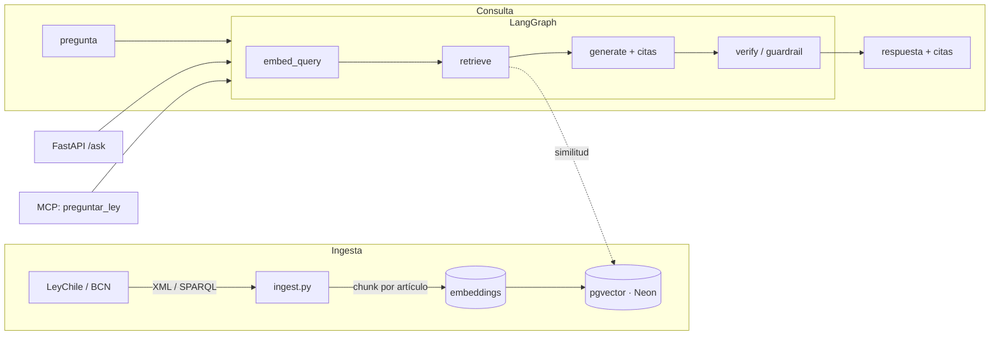

# leychile-rag

**RAG agentic sobre la legislación chilena.** Hacés una pregunta en lenguaje
natural y obtenés una respuesta **fundada en los artículos de la ley, con citas**
(norma + artículo + link) — no una alucinación. MVP sobre el **Código del Trabajo**.

Construido con **LangGraph** (RAG agentic con guardrails), **FastAPI**, **pgvector
sobre Neon** y expuesto también como **servidor MCP** para que cualquier agente
(Claude Desktop, Cursor) pueda consultar la ley chilena como una tool.

> Proyecto personal / demo. No es asesoría legal: orienta y remite a la fuente oficial.

## Arquitectura



El grafo recupera los artículos más relevantes, redacta la respuesta **citando**
los artículos usados y, en `verify`, degrada a *"no encontrado en el corpus"* si
no hubo recuperación — anti-alucinación.

## Stack
Python · LangGraph · LangChain · OpenAI embeddings · Postgres + pgvector (Neon) ·
FastAPI · MCP (Model Context Protocol).

## Quick start

```bash
python -m venv .venv && source .venv/bin/activate
pip install -r requirements.txt
pip install -e .
cp .env.example .env           # completar OPENAI_API_KEY y DATABASE_URL (Neon)

# Ingesta (seed = muestra incluida; leychile = baja el XML real)
python scripts/run_ingest.py seed

# API
uvicorn leychile_rag.api:app --reload
curl -s localhost:8000/ask -H 'content-type: application/json' \
  -d '{"pregunta":"¿Con cuánta anticipación debe avisar un trabajador si renuncia?"}'
```

### Como servidor MCP

```bash
pip install mcp
python -m leychile_rag.mcp_server
```

Expone la tool `preguntar_ley(pregunta)` para cualquier cliente MCP. Se puede
combinar con [`mcp-datos-gob-cl`](https://github.com/MarcoValdiviesoB/mcp-datos-gob-cl)
(datos públicos de Chile) para un agente que cruza **datos + ley**.

## Fuente de datos
Textos legales desde **LeyChile / BCN** (Biblioteca del Congreso Nacional).
El servicio XML puede requerir credencial o haber cambiado de endpoint y puede
rate-limitar; la ingesta cachea y soporta un modo `seed` para correr el demo sin
depender del fetch. El `data/codigo_trabajo_sample.json` es **muestra ilustrativa**,
no fuente legal.

## Roadmap
- [ ] Parser robusto del XML/XSD de LeyChile (hoy regex tolerante).
- [ ] Más cuerpos legales (Protección de Datos, Código Tributario).
- [ ] Reranking + evaluación (eval set de preguntas laborales con respuestas citadas).
- [ ] Deploy (Fly.io) + UI de chat mínima.
- [ ] Observabilidad de las trazas del agente.

## Licencia
MIT.
